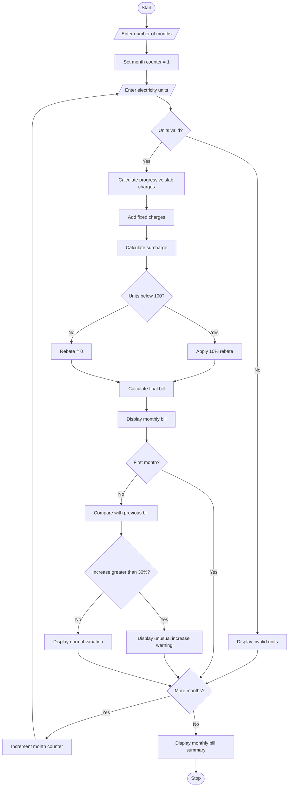

 # Progressive Electricity Billing System Using Python

## 1. Problem Statement

Develop a Python program to calculate household electricity bills using a progressive slab-based billing system.

The program should:

- Accept electricity consumption (units) for multiple months.
- Calculate charges based on different consumption slabs.
- Add fixed charges and surcharges.
- Apply rebates or discounts.
- Calculate the final electricity bill for each month.
- Compare bills across multiple months.
- Identify unusual increases in electricity bills.

### Electricity Tariff Slabs

The following sample tariff rates are used:

| Consumption slab | Rate per unit |
| --- | --- |
| 0–100 units | ₹2.00 |
| 101–200 units | ₹3.00 |
| 201–300 units | ₹5.00 |
| Above 300 units | ₹7.00 |

Additional charges:

- Fixed charge = ₹50
- Surcharge = 5% of energy charge
- Rebate = 10% of energy charge if consumption is below 100 units.
- Unusual increase = Bill increases by more than 30% compared to the previous month.

## 2. Algorithm

1. Start the program.
2. Read the number of months.
3. For each month, input electricity consumption in units.
4. Calculate energy charges using progressive slabs:
   - First 100 units: ₹2 per unit.
   - Next 100 units: ₹3 per unit.
   - Next 100 units: ₹5 per unit.
   - Above 300 units: ₹7 per unit.
5. Add fixed charges of ₹50.
6. Calculate a surcharge of 5% on energy charges.
7. If consumption is below 100 units, apply a 10% rebate on energy charges.
8. Calculate the final bill.
9. Display the monthly electricity bill.
10. Compare the current month's bill with the previous month's bill.
11. If the increase is greater than 30%, display an unusual increase warning.
12. Repeat for all months.
13. Display the monthly bill summary.
14. Stop.

## 3. Flowchart


```

flowchart TD
    A([Start]) --> B[/Enter number of months/]
    B --> C[Set month counter = 1]
    C --> D[/Enter electricity units/]
    D --> E{Units valid?}

    E -->|No| F[Display invalid units]
    F --> K{More months?}

    E -->|Yes| G[Calculate progressive slab charges]

    G --> H[Add fixed charges]
    H --> I[Calculate surcharge]
    I --> J{Units below 100?}

    J -->|Yes| L[Apply 10% rebate]
    J -->|No| M[Rebate = 0]

    L --> N[Calculate final bill]
    M --> N

    N --> O[Display monthly bill]
    O --> P{First month?}

    P -->|No| Q[Compare with previous bill]
    Q --> R{Increase greater than 30%?}
    R -->|Yes| S[Display unusual increase warning]
    R -->|No| T[Display normal variation]

    P -->|Yes| K
    S --> K
    T --> K

    K -->|Yes| U[Increment month counter]
    U --> D

    K -->|No| V[Display monthly bill summary]
    V --> W([Stop])

```

## 5. Sample Input

text

```text
Enter number of months: 4

Month 1
Enter electricity units consumed: 80

Month 2
Enter electricity units consumed: 120

Month 3
Enter electricity units consumed: 180

Month 4
Enter electricity units consumed: 280
```

## 6. Sample Output

text

```text
Month 1
Energy Charge: Rs. 160.0
Fixed Charge: Rs. 50
Surcharge: Rs. 8.0
Rebate: Rs. 16.0
Final Bill: Rs. 202.0

Month 2
Energy Charge: Rs. 260.0
Fixed Charge: Rs. 50
Surcharge: Rs. 13.0
Rebate: Rs. 0
Final Bill: Rs. 323.0
Bill Change: 59.9 %
WARNING: Unusual increase detected!

Month 3
Energy Charge: Rs. 440.0
Fixed Charge: Rs. 50
Surcharge: Rs. 22.0
Rebate: Rs. 0
Final Bill: Rs. 512.0
Bill Change: 58.51 %
WARNING: Unusual increase detected!

Month 4
Energy Charge: Rs. 840.0
Fixed Charge: Rs. 50
Surcharge: Rs. 42.0
Rebate: Rs. 0
Final Bill: Rs. 932.0
Bill Change: 82.03 %
WARNING: Unusual increase detected!

----- MONTHLY BILL SUMMARY -----
Month 1 : Rs. 202.0
Month 2 : Rs. 323.0
Month 3 : Rs. 512.0
Month 4 : Rs. 932.0

Total Bill: Rs. 1969.0
Average Bill: Rs. 492.25

Billing Process Completed.
```

## 7. Mermaid Flowchart Code

You can copy this code into the [Mermaid Live Editor](<https://mermaid.live/?utm_source=chatgpt.com>) to generate the flowchart.

mermaid



## 8. Expected Result

The program successfully calculates electricity bills using progressive consumption slabs, fixed charges, surcharges, and rebates. It compares monthly bills, calculates total and average bills, and identifies unusual increases greater than 30%.

Conclusion: This Python-based Progressive Electricity Billing System simplifies household electricity bill calculation and helps consumers monitor monthly electricity expenses and detect unexpected increases.
