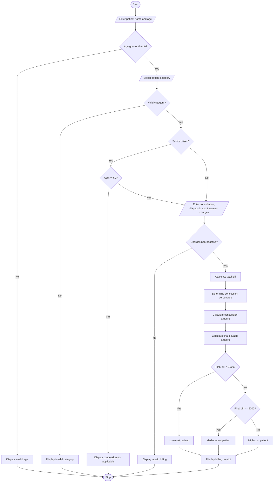

# Hospital Billing and Patient Classification Using Python

## 1. Problem Statement

Develop a Python program to calculate hospital bills based on consultation charges, diagnostic charges, and treatment charges.

The program should:

- Accept patient details such as patient name, age, and patient type.
- Accept consultation, diagnostic, and treatment charges.
- Calculate the total hospital bill.
- Apply conditional concessions based on patient category.
- Validate billing constraints such as negative charges and invalid patient details.
- Calculate the final payable amount after concessions.
- Classify patients according to a supplied payment policy.
- Display a detailed billing receipt.

### Billing Policy

The following sample hospital billing policy is considered:

Charges and concessions

| Patient category | Concession |
| --- | --- |
| General patient | 0% |
| Senior citizen (age 60 or above) | 10% |
| Below poverty line (BPL) | 20% |
| Insurance patient | 15% |

Patient classification based on final bill

| Final bill amount | Classification |
| --- | --- |
| Below ₹1,000 | Low-cost patient |
| ₹1,000–₹5,000 | Medium-cost patient |
| Above ₹5,000 | High-cost patient |

Additional rules:

- All charges must be non-negative.
- Patient age must be greater than zero.
- Only one concession category can be applied.
- Concession is calculated on the total bill.
- Final payable amount cannot be negative.

## 2. Algorithm

1. Start the program.
2. Input patient name and age.
3. Validate the patient's age.
4. Input patient category (General, Senior Citizen, BPL, or Insurance).
5. Input consultation charges.
6. Input diagnostic charges.
7. Input treatment charges.
8. Validate that all charges are non-negative.
9. Calculate the total bill:

Total Bill = Consultation + Diagnostic + Treatment. 10. Determine the applicable concession percentage based on patient category. 11. Calculate the concession amount. 12. Calculate the final payable amount:

Final Bill = Total Bill − Concession. 13. Classify the patient based on the final bill amount. 14. Display the patient's details and billing receipt. 15. Stop.


```

flowchart TD
    A([Start]) --> B[/Enter patient name and age/]
    B --> C{Age greater than 0?}

    C -->|No| D[Display invalid age]
    D --> Z([Stop])

    C -->|Yes| E[/Select patient category/]
    E --> F{Valid category?}

    F -->|No| G[Display invalid category]
    G --> Z

    F -->|Yes| H{Senior citizen?}

    H -->|Yes| I{Age >= 60?}
    I -->|No| J[Display concession not applicable]
    J --> Z
    I -->|Yes| K[/Enter consultation, diagnostic and treatment charges/]

    H -->|No| K

    K --> L{Charges non-negative?}
    L -->|No| M[Display invalid billing]
    M --> Z

    L -->|Yes| N[Calculate total bill]
    N --> O[Determine concession percentage]
    O --> P[Calculate concession amount]
    P --> Q[Calculate final payable amount]

    Q --> R{Final bill < 1000?}
    R -->|Yes| S[Low-cost patient]

    R -->|No| T{Final bill <= 5000?}
    T -->|Yes| U[Medium-cost patient]
    T -->|No| V[High-cost patient]

    S --> W[Display billing receipt]
    U --> W
    V --> W

    W --> Z([Stop])

```

## 5. Sample Input

text

```text
===== HOSPITAL BILLING SYSTEM =====

Enter patient name: Ravi
Enter patient age: 65

Patient Categories:
1. General
2. Senior Citizen
3. BPL
4. Insurance

Enter category choice: 2

Enter consultation charges: 500
Enter diagnostic charges: 1500
Enter treatment charges: 4000
```

## 6. Sample Output

text

```text
===== HOSPITAL BILL RECEIPT =====

Patient Name: Ravi
Patient Age: 65
Patient Category: Senior

Consultation Charges: Rs. 500.0
Diagnostic Charges: Rs. 1500.0
Treatment Charges: Rs. 4000.0

---------------------------------
Total Bill: Rs. 6000.0
Concession Rate: 10 %
Concession Amount: Rs. 600.0
Final Payable Amount: Rs. 5400.0

---------------------------------
Patient Classification: High-cost Patient

Thank you for choosing our hospital!
```

## 7. Mermaid Flowchart Code

Copy the following code into the [Mermaid Live Editor](<https://mermaid.live/?utm_source=chatgpt.com>) to generate the flowchart.

mermaid



## 8. Expected Result

The program successfully:

- Calculates consultation, diagnostic, and treatment charges.
- Applies concessions based on patient category.
- Validates patient age, category, and billing amounts.
- Calculates the final payable hospital bill.
- Classifies patients into low-cost, medium-cost, and high-cost categories.
- Generates a detailed hospital billing receipt.

Conclusion: The Hospital Billing and Patient Classification System automates hospital bill calculation, applies conditional concessions, validates billing information, and classifies patients according to the given payment policy.
