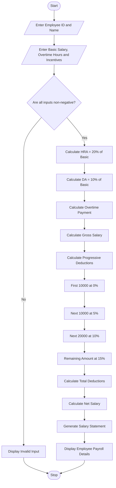

# Employee Payroll and Deduction Analysis Using Python

## 1. Problem Statement

Develop a Python program to calculate employee salaries based on basic pay, allowances, overtime, and incentives. The program should calculate the gross salary and apply progressive deductions according to predefined salary slabs.

The program should:

- Accept employee details such as employee ID, name, and basic salary.
- Calculate allowances such as House Rent Allowance (HRA) and Dearness Allowance (DA).
- Calculate overtime payment and incentives.
- Calculate gross salary.
- Apply progressive deductions based on gross salary.
- Calculate net salary after deductions.
- Validate salary inputs to prevent negative values.
- Generate a formatted employee salary statement.

### Salary Calculation Policy

Allowances and additional payments

| Component | Rate |
| --- | --- |
| HRA | 20% of basic pay |
| DA | 10% of basic pay |
| Overtime | ₹200 per hour |
| Incentive | Entered by employee |

Progressive deduction slabs

| Gross salary slab | Deduction rate |
| --- | --- |
| First ₹10,000 | 0% |
| Next ₹10,000 | 5% |
| Next ₹20,000 | 10% |
| Above ₹40,000 | 15% |

Note: These are illustrative payroll rules for this programming exercise, not official tax or statutory deduction rates.

Formulas

1. HRA = Basic Pay × 20 / 100
2. DA = Basic Pay × 10 / 100
3. Overtime Pay = Overtime Hours × ₹200
4. Gross Salary = Basic Pay + HRA + DA + Overtime Pay + Incentives
5. Net Salary = Gross Salary − Total Deductions

## 2. Algorithm

1. Start the program.
2. Input employee ID and employee name.
3. Input basic salary.
4. Input overtime hours.
5. Input incentive amount.
6. Validate all inputs to ensure they are non-negative.
7. Calculate HRA as 20% of basic salary.
8. Calculate DA as 10% of basic salary.
9. Calculate overtime payment at ₹200 per hour.
10. Calculate gross salary by adding basic pay, allowances, overtime, and incentives.
11. Calculate progressive deductions:
    - First ₹10,000: 0%.
    - Next ₹10,000: 5%.
    - Next ₹20,000: 10%.
    - Remaining amount above ₹40,000: 15%.
12. Calculate total deductions.
13. Calculate net salary.
14. Generate and display the formatted salary statement.
15. Stop.


## 4. Python Source Code

python

```


flowchart TD
    A([Start]) --> B[/Enter Employee ID and Name/]
    B --> C[/Enter Basic Salary, Overtime Hours and Incentives/]

    C --> D{Are all inputs non-negative?}

    D -->|No| E[Display Invalid Input]
    E --> Z([Stop])

    D -->|Yes| F[Calculate HRA = 20% of Basic]
    F --> G[Calculate DA = 10% of Basic]
    G --> H[Calculate Overtime Payment]
    H --> I[Calculate Gross Salary]

    I --> J[Calculate Progressive Deductions]

    J --> K[First 10000 at 0%]
    K --> L[Next 10000 at 5%]
    L --> M[Next 20000 at 10%]
    M --> N[Remaining Amount at 15%]

    N --> O[Calculate Total Deductions]
    O --> P[Calculate Net Salary]

    P --> Q[Generate Salary Statement]
    Q --> R[Display Employee Payroll Details]

    R --> Z([Stop])

```

## 5. Sample Input

text

```text
===== EMPLOYEE PAYROLL SYSTEM =====

Enter Employee ID: E101
Enter Employee Name: Ravi
Enter Basic Salary: Rs. 30000
Enter Overtime Hours: 10
Enter Incentive Amount: Rs. 5000
```

## 6. Sample Output

text

```text
========================================
         EMPLOYEE SALARY STATEMENT
========================================

Employee ID       : E101
Employee Name     : Ravi

----------------------------------------
Basic Salary      : Rs. 30000.0
HRA (20%)         : Rs. 6000.0
DA (10%)          : Rs. 3000.0
Overtime Payment  : Rs. 2000.0
Incentives        : Rs. 5000.0

----------------------------------------
Gross Salary      : Rs. 46000.0
Total Deductions  : Rs. 3900.0
----------------------------------------
NET SALARY        : Rs. 42100.0
========================================

Payroll Calculation Completed.
```

### Deduction Calculation

For gross salary of ₹46,000:

| Salary portion | Rate | Deduction |
| --- | --- | --- |
| First ₹10,000 | 0% | ₹0 |
| Next ₹10,000 | 5% | ₹500 |
| Next ₹20,000 | 10% | ₹2,000 |
| Remaining ₹6,000 | 15% | ₹900 |
| Total |  | ₹3,400 |

Corrected deduction total: ₹3,400Therefore:

Net Salary = ₹46,000 − ₹3,400 = ₹42,600.

## 7. Mermaid Flowchart Code

Copy the following code into the [Mermaid Live Editor](<https://mermaid.live/?utm_source=chatgpt.com>) to generate the flowchart.

mermaid



## 8. Expected Result

The program successfully:

- Calculates gross salary using basic pay, HRA, DA, overtime, and incentives.
- Applies progressive deductions using multiple salary slabs.
- Validates salary-related inputs.
- Calculates the final net salary.
- Generates a formatted employee salary statement.

Conclusion: The Employee Payroll and Deduction Analysis System automates salary calculations, applies progressive deductions, reduces manual calculation errors, and generates an organized salary statement for employees.
