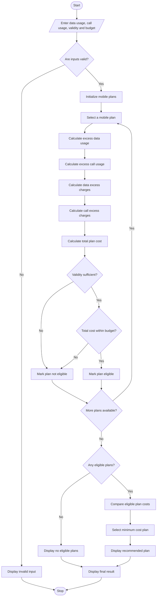

# Multi-Plan Telecommunications Cost Optimization Using Python

## 1. Problem Statement

Develop a Python program to evaluate multiple mobile telecommunications plans based on a user's data usage, call usage, validity period, and budget constraints.

The program should:

- Accept user requirements such as monthly data usage, call minutes, required validity, and budget.
- Accept details of multiple mobile plans.
- Calculate excess data charges when usage exceeds the plan's data limit.
- Calculate excess call charges when call usage exceeds the plan's call limit.
- Calculate the total cost of each mobile plan.
- Check whether each plan satisfies the user's budget and validity requirements.
- Identify eligible plans.
- Compare the costs of eligible plans.
- Recommend the most economical eligible mobile plan.

### Sample Mobile Plan Details

The following tariff details are used for this programming exercise.

| Plan | Price | Data limit | Call limit | Validity |
| --- | --- | --- | --- | --- |
| Plan A | ₹199 | 2 GB | 200 min | 28 days |
| Plan B | ₹299 | 5 GB | 500 min | 28 days |
| Plan C | ₹399 | 10 GB | 1000 min | 56 days |
| Plan D | ₹499 | 15 GB | 1500 min | 84 days |

### Excess Usage Charges

- Excess data charge = ₹20 per GB.
- Excess call charge = ₹1 per minute.

### Eligibility Conditions

A mobile plan is eligible if:

1. Total cost does not exceed the user's budget.
2. Plan validity is greater than or equal to the required validity.
3. The plan's total cost includes all excess usage charges.

Formula:

$$
\text{Total Cost} = \text{Plan Price} + \text{Data Excess Charge} + \text{Call Excess Charge}
$$

$$
\text{Data Excess Charge} =
\max(0,\text{Used Data}-\text{Data Limit})\times 20
$$

$$
\text{Call Excess Charge} =
\max(0,\text{Used Minutes}-\text{Call Limit})\times 1
$$

## 2. Algorithm

1. Start the program.
2. Input the user's data usage in GB.
3. Input the user's call usage in minutes.
4. Input the required validity period.
5. Input the user's maximum budget.
6. Define the available mobile plans with their prices, data limits, call limits, and validity periods.
7. For each mobile plan:
   - Calculate excess data usage.
   - Calculate excess call usage.
   - Calculate excess data charges.
   - Calculate excess call charges.
   - Calculate the total plan cost.
8. Check whether the plan satisfies the validity requirement.
9. Check whether the total cost is within the user's budget.
10. If both conditions are satisfied, mark the plan as eligible.
11. Repeat the process for all available plans.
12. Compare the total costs of eligible plans.
13. Identify the plan with the lowest total cost.
14. Display all plan details and eligibility status.
15. Display the most economical eligible plan.
16. If no plan is eligible, display a suitable message.
17. Stop.


## 4. Python Source Code

python

```

flowchart TD
    A([Start]) --> B[/Enter data usage, call usage, validity and budget/]

    B --> C{Are inputs valid?}

    C -->|No| D[Display invalid input]
    D --> Z([Stop])

    C -->|Yes| E[Initialize mobile plans]
    E --> F[Select a mobile plan]

    F --> G[Calculate excess data usage]
    G --> H[Calculate excess call usage]

    H --> I[Calculate data excess charges]
    I --> J[Calculate call excess charges]

    J --> K[Calculate total plan cost]

    K --> L{Validity sufficient?}

    L -->|No| M[Mark plan not eligible]
    L -->|Yes| N{Total cost within budget?}

    N -->|No| M
    N -->|Yes| O[Mark plan eligible]

    M --> P{More plans available?}
    O --> P

    P -->|Yes| F
    P -->|No| Q{Any eligible plans?}

    Q -->|No| R[Display no eligible plans]
    Q -->|Yes| S[Compare eligible plan costs]

    S --> T[Select minimum cost plan]
    T --> U[Display recommended plan]

    R --> V[Display final result]
    U --> V

    V --> Z([Stop])


```

## 5. Sample Input

text

```text
===== TELECOM PLAN OPTIMIZATION =====

Enter data usage (GB): 4
Enter call usage (minutes): 400
Enter required validity (days): 28
Enter maximum budget (Rs.): 400
```

## 6. Sample Output

text

```text
========== PLAN COMPARISON ==========

Plan: Plan A
Base Price: Rs. 199
Excess Data Charge: Rs. 40.0
Excess Call Charge: Rs. 200.0
Total Cost: Rs. 439.0
Validity: 28 days
Status: Not Eligible

Plan: Plan B
Base Price: Rs. 299
Excess Data Charge: Rs. 0
Excess Call Charge: Rs. 0
Total Cost: Rs. 299.0
Validity: 28 days
Status: Eligible

Plan: Plan C
Base Price: Rs. 399
Excess Data Charge: Rs. 0
Excess Call Charge: Rs. 0
Total Cost: Rs. 399.0
Validity: 56 days
Status: Eligible

Plan: Plan D
Base Price: Rs. 499
Excess Data Charge: Rs. 0
Excess Call Charge: Rs. 0
Total Cost: Rs. 499.0
Validity: 84 days
Status: Not Eligible

========== FINAL RESULT ==========

Most Economical Plan: Plan B
Total Cost: Rs. 299.0
Validity: 28 days

All Eligible Plans:

Plan B - Rs. 299.0
Plan C - Rs. 399.0

Optimization Completed.
```

## 7. Mermaid Flowchart Code

Copy the following code into the [Mermaid Live Editor](<https://mermaid.live/?utm_source=chatgpt.com>) to generate the flowchart.

mermaid



## 8. Expected Result

The program successfully:

- Evaluates multiple telecommunications plans.
- Calculates excess data and call charges.
- Determines the total cost of each plan.
- Checks budget and validity constraints.
- Identifies eligible mobile plans.
- Selects the most economical eligible plan.
- Displays a comparison of all available plans.

Conclusion: The Multi-Plan Telecommunications Cost Optimization System helps users compare mobile plans based on usage, validity, and budget. It calculates additional charges and recommends the lowest-cost eligible plan, helping users make economical telecommunications decisions.
