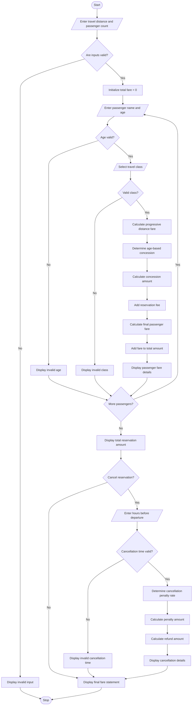

# Railway Fare and Reservation Calculator Using Python

## 1. Problem Statement

Develop a Python program to calculate railway ticket fares for multiple passengers based on travel distance, travel class, age-based concessions, reservation fees, and cancellation penalties.

The program should:

- Accept the number of passengers.
- Accept passenger details such as name and age.
- Accept travel distance in kilometres.
- Allow passengers to select a travel class.
- Calculate basic fare using different distance slabs.
- Apply age-based concessions according to passenger eligibility.
- Add reservation fees based on travel class.
- Calculate the final ticket fare for each passenger.
- Calculate the total reservation amount for all passengers.
- Calculate cancellation penalties when a ticket is cancelled.
- Generate a detailed railway fare statement.

### Railway Fare Policy

The following sample fare structure is used for this programming exercise.

Distance-based basic fare

| Distance slab | Fare per km |
| --- | --- |
| First 100 km | ₹1.50 |
| Next 200 km | ₹1.20 |
| Next 200 km | ₹1.00 |
| Above 500 km | ₹0.80 |

Travel class charges

| Travel class | Reservation fee |
| --- | --- |
| Sleeper | ₹40 |
| AC 3 Tier | ₹100 |
| AC 2 Tier | ₹150 |
| AC 1 Tier | ₹200 |

Age-based concessions

| Passenger category | Age | Concession |
| --- | --- | --- |
| Child | Below 5 | 100% |
| Child | 5–11 | 50% |
| Adult | 12–59 | 0% |
| Senior citizen | 60 and above | 10% |

Cancellation penalty policy

| Cancellation time | Penalty |
| --- | --- |
| More than 48 hours before departure | 10% |
| 12–48 hours before departure | 25% |
| Less than 12 hours before departure | 50% |

Note: These are illustrative rates and policies for a Python programming exercise, not actual Indian Railways fares or cancellation rules.

### Important Formulas

1. Basic Fare

$$
BF = \sum(\text{Distance in slab}\times\text{Rate})
$$

2. Concession Amount

$$
CA = BF \times \frac{\text{Concession Rate}}{100}
$$

3. Final Ticket Fare

$$
TF = BF - CA + RF
$$

Where:

- BF = Basic Fare
- CA = Concession Amount
- RF = Reservation Fee

4. Cancellation Amount

$$
CP = TF \times \frac{\text{Penalty Rate}}{100}
$$

$$
Refund = TF - CP
$$

## 2. Algorithm

1. Start the program.
2. Input the number of passengers.
3. Input the travel distance.
4. Validate that distance is positive.
5. For each passenger:
   - Enter passenger name.
   - Enter passenger age.
   - Select travel class.
6. Calculate the basic fare using progressive distance slabs.
7. Determine the passenger's age category.
8. Apply the appropriate age-based concession.
9. Calculate the reservation fee according to travel class.
10. Calculate the final ticket fare.
11. Display the passenger's fare details.
12. Repeat the process for all passengers.
13. Calculate the total reservation amount.
14. Ask whether the reservation should be cancelled.
15. If cancelled:

- Input the cancellation time before departure.
- Determine the applicable cancellation penalty.
- Calculate the refund amount.

16. Display the final railway fare statement.
17. Stop.


## 4. Python Source Code

python

```

flowchart TD

    A([Start]) --> B[/Enter travel distance and passenger count/]

    B --> C{Are inputs valid?}

    C -->|No| D[Display invalid input]
    D --> Z([Stop])

    C -->|Yes| E[Initialize total fare = 0]

    E --> F[/Enter passenger name and age/]

    F --> G{Age valid?}

    G -->|No| H[Display invalid age]
    H --> N{More passengers?}

    G -->|Yes| I[/Select travel class/]

    I --> J{Valid class?}

    J -->|No| K[Display invalid class]
    K --> N

    J -->|Yes| L[Calculate progressive distance fare]

    L --> M[Determine age-based concession]

    M --> O[Calculate concession amount]

    O --> P[Add reservation fee]

    P --> Q[Calculate final passenger fare]

    Q --> R[Add fare to total amount]

    R --> S[Display passenger fare details]

    S --> N

    N -->|Yes| F

    N -->|No| T[Display total reservation amount]

    T --> U{Cancel reservation?}

    U -->|No| V[Display final fare statement]

    U -->|Yes| W[/Enter hours before departure/]

    W --> X{Cancellation time valid?}

    X -->|No| Y[Display invalid cancellation time]

    X -->|Yes| AA[Determine cancellation penalty rate]

    AA --> AB[Calculate penalty amount]

    AB --> AC[Calculate refund amount]

    AC --> AD[Display cancellation details]

    Y --> V
    AD --> V

    V --> Z([Stop])

```

## 5. Sample Input

text

```text
===== RAILWAY FARE AND RESERVATION SYSTEM =====

Enter travel distance (km): 400
Enter number of passengers: 3

Passenger 1
Enter passenger name: Ravi
Enter passenger age: 35

Travel Classes:
1. Sleeper
2. AC 3 Tier
3. AC 2 Tier
4. AC 1 Tier

Select travel class: 1

Passenger 2
Enter passenger name: Sita
Enter passenger age: 65

Select travel class: 2

Passenger 3
Enter passenger name: Arun
Enter passenger age: 10

Select travel class: 3

Do you want to cancel the reservation? (yes/no): yes

Enter hours before departure: 24
```

## 6. Sample Output

text

```text
========== RAILWAY FARE RECEIPT ==========

Passenger Name: Ravi
Age: 35
Travel Class: Sleeper
Basic Fare: Rs. 440.0
Concession: Rs. 0.0
Reservation Fee: Rs. 40
Final Fare: Rs. 480.0

Passenger Name: Sita
Age: 65
Travel Class: AC 3 Tier
Basic Fare: Rs. 440.0
Concession: Rs. 44.0
Reservation Fee: Rs. 100
Final Fare: Rs. 496.0

Passenger Name: Arun
Age: 10
Travel Class: AC 2 Tier
Basic Fare: Rs. 440.0
Concession: Rs. 220.0
Reservation Fee: Rs. 150
Final Fare: Rs. 370.0

------------------------------------------
Total Passengers: 3
Total Reservation Amount: Rs. 1346.0

===== CANCELLATION DETAILS =====
Cancellation Penalty: 25 %
Penalty Amount: Rs. 336.5
Refund Amount: Rs. 1009.5

Railway Calculation Completed.
```

### Calculation Verification

For a distance of 400 km:

| Distance | Rate | Fare |
| --- | --- | --- |
| First 100 km | ₹1.50 | ₹150 |
| Next 200 km | ₹1.20 | ₹240 |
| Next 100 km | ₹1.00 | ₹100 |
| Total basic fare |  | ₹490 |

Correction to sample calculationsThe correct basic fare is ₹490, not ₹440. Therefore, the corrected passenger and cancellation results are:

| Passenger | Final fare |
| --- | --- |
| Ravi | ₹530 |
| Sita | ₹541 |
| Arun | ₹395 |
| Total | ₹1,466 |

- Cancellation penalty (25%): ₹366.50
- Refund amount: ₹1,099.50

## 7. Mermaid Flowchart Code

Copy the following code into the [Mermaid Live Editor](<https://mermaid.live/?utm_source=chatgpt.com>) to generate the flowchart.

mermaid



## 8. Expected Result

The program successfully:

- Calculates railway fares using progressive distance slabs.
- Supports multiple passengers.
- Calculates fares for different travel classes.
- Applies age-based concessions.
- Adds reservation fees.
- Calculates total reservation costs.
- Determines cancellation penalties.
- Calculates refund amounts.
- Generates a detailed railway fare statement.

Conclusion: The Railway Fare and Reservation Calculator automates railway ticket fare calculations for multiple passengers. It considers distance, travel class, age-based concessions, reservation fees, and cancellation penalties to provide accurate fare and refund calculations according to the specified sample policy.
