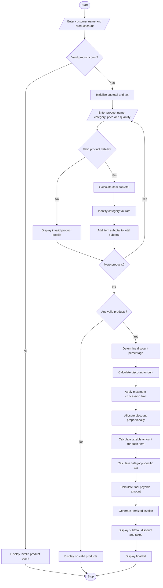

# Retail Billing with Multiple Discount Rules Using Python

## 1. Problem Statement

Develop a Python program to generate a retail shopping bill by processing multiple products, their quantities, category-specific taxes, and different discount rules.

The program should:

- Accept customer details and the number of products purchased.
- Accept product name, category, price, and quantity for each product.
- Calculate the subtotal for each product.
- Apply category-specific tax rates.
- Apply threshold-based discounts depending on the total purchase amount.
- Apply a maximum concession limit to prevent excessive discounts.
- Calculate the final payable amount.
- Generate an itemized invoice containing product details, taxes, discounts, and the total bill.

### Retail Billing Policy

The following sample billing rules are used.

Category-specific taxes

| Product category | Tax rate |
| --- | --- |
| Electronics | 18% |
| Clothing | 5% |
| Grocery | 0% |
| Furniture | 12% |

Threshold-based discounts

| Purchase amount | Discount |
| --- | --- |
| Below ₹1,000 | 0% |
| ₹1,000–₹4,999 | 5% |
| ₹5,000–₹9,999 | 10% |
| ₹10,000 and above | 15% |

Maximum concession limit

- Maximum discount = ₹2,000.
- Discount is calculated on the subtotal before taxes.
- Tax is calculated after applying the discount.
- Maximum discount cannot exceed the subtotal.

### Important Formulas

1. Item Subtotal

$$
\text{Item Subtotal} = \text{Price} \times \text{Quantity}
$$

2. Discount Amount

$$
\text{Discount} = \text{Subtotal} \times
\frac{\text{Discount Rate}}{100}
$$

3. Maximum Concession

$$
\text{Final Discount} =
\min(\text{Calculated Discount},2000,\text{Subtotal})
$$

4. Taxable Amount

$$
\text{Taxable Amount} = \text{Subtotal} - \text{Discount}
$$

5. Final Bill

$$
\text{Final Bill} =
\text{Taxable Amount} + \text{Total Tax}
$$

## 2. Algorithm

1. Start the program.
2. Input customer name.
3. Input the number of products purchased.
4. Initialize subtotal and tax variables to zero.
5. For each product:
   - Input product name.
   - Input product category.
   - Input product price.
   - Input product quantity.
6. Validate product price and quantity.
7. Calculate the item subtotal using price multiplied by quantity.
8. Determine the tax rate according to the product category.
9. Calculate the total purchase subtotal.
10. Determine the discount percentage based on the purchase threshold.
11. Calculate the discount amount.
12. Apply the maximum concession limit of ₹2,000.
13. Calculate the taxable amount after discount.
14. Calculate category-specific taxes proportionally on each item's discounted value.
15. Calculate the final payable amount.
16. Generate an itemized invoice.
17. Display subtotal, discount, taxes, and final bill.
18. Stop.


## 4. Python Source Code

python

```

flowchart TD

    A([Start]) --> B[/Enter customer name and product count/]

    B --> C{Valid product count?}

    C -->|No| D[Display invalid product count]
    D --> Z([Stop])

    C -->|Yes| E[Initialize subtotal and tax]

    E --> F[/Enter product name, category, price and quantity/]

    F --> G{Valid product details?}

    G -->|No| H[Display invalid product details]
    H --> I{More products?}

    G -->|Yes| J[Calculate item subtotal]

    J --> K[Identify category tax rate]

    K --> L[Add item subtotal to total subtotal]

    L --> I

    I -->|Yes| F

    I -->|No| M{Any valid products?}

    M -->|No| N[Display no valid products]
    N --> Z

    M -->|Yes| O[Determine discount percentage]

    O --> P[Calculate discount amount]

    P --> Q[Apply maximum concession limit]

    Q --> R[Allocate discount proportionally]

    R --> S[Calculate taxable amount for each item]

    S --> T[Calculate category-specific tax]

    T --> U[Calculate final payable amount]

    U --> V[Generate itemized invoice]

    V --> W[Display subtotal, discount and taxes]

    W --> X[Display final bill]

    X --> Z([Stop])

```

## 5. Sample Input

text

```text
===== RETAIL BILLING SYSTEM =====

Enter customer name: Ravi
Enter number of products: 3

Product 1
Enter product name: Laptop
Enter category: Electronics
Enter unit price: Rs. 40000
Enter quantity: 1

Product 2
Enter product name: Shirt
Enter category: Clothing
Enter unit price: Rs. 2000
Enter quantity: 2

Product 3
Enter product name: Rice
Enter category: Grocery
Enter unit price: Rs. 1000
Enter quantity: 2
```

## 6. Sample Output

For the above input:

- Total subtotal = ₹46,000
- Discount rate = 15%
- Calculated discount = ₹6,900
- Maximum discount = ₹2,000
- Final discount = ₹2,000

text

```text
========== ITEMIZED INVOICE ==========

Customer Name: Ravi

--------------------------------------

Product: Laptop
Category: Electronics
Unit Price: Rs. 40000.0
Quantity: 1
Subtotal: Rs. 40000.0
Discount: Rs. 1739.13
Tax Rate: 18 %
Tax Amount: Rs. 6886.96

Product: Shirt
Category: Clothing
Unit Price: Rs. 2000.0
Quantity: 2
Subtotal: Rs. 4000.0
Discount: Rs. 173.91
Tax Rate: 5 %
Tax Amount: Rs. 191.30

Product: Rice
Category: Grocery
Unit Price: Rs. 1000.0
Quantity: 2
Subtotal: Rs. 2000.0
Discount: Rs. 86.96
Tax Rate: 0 %
Tax Amount: Rs. 0.0

--------------------------------------
Total Subtotal: Rs. 46000.0
Discount Rate: 15 %
Total Discount: Rs. 2000.0
Taxable Amount: Rs. 44000.0
Total Tax: Rs. 7078.26

--------------------------------------
FINAL BILL: Rs. 51078.26

======================================
Thank you for shopping!
```

## 7. Mermaid Flowchart Code

Copy the following code into the [Mermaid Live Editor](<https://mermaid.live/?utm_source=chatgpt.com>) to generate the flowchart.

mermaid



## 8. Expected Result

The program successfully:

- Processes multiple products and quantities.
- Calculates individual product subtotals.
- Applies category-specific tax rates.
- Calculates threshold-based discounts.
- Enforces the maximum concession limit.
- Allocates discounts proportionally across products.
- Calculates the final payable amount.
- Generates a detailed itemized invoice.

Conclusion: The Retail Billing with Multiple Discount Rules system automates retail invoice generation by combining product-wise calculations, category-specific taxes, threshold discounts, and maximum concession limits. It reduces manual billing errors and provides customers with a clear breakdown of their purchases.
